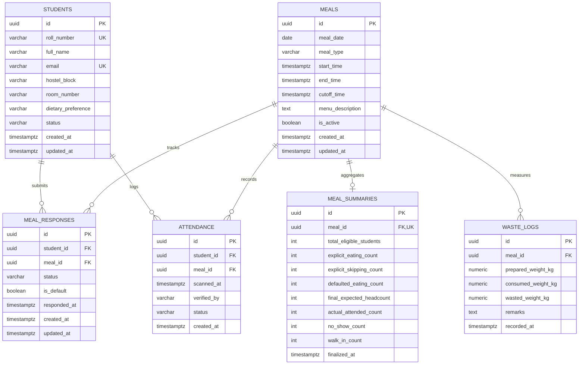

# Campus Mess Food Waste Management — Backend Architecture & Design Document

**Document Version:** 1.0.0  
**Git Branch:** `feature/backend`  
**Status:** Proposed / Pending Team Review  
**Author:** Backend Architecture Team  

---

## 1. Executive Summary & Context

### 1.1 Purpose
The **Campus Mess Food Waste Management System** addresses the critical issue of food wastage in university/college dining halls. Mess authorities typically prepare food based on crude estimates or total enrolled students, resulting in massive food surplus (when students skip meals) or sudden shortages (due to unplanned rushes).

This system provides:
1. **Accurate Forecasting**: Real-time visibility into student attendance intent through a time-gated meal polling workflow.
2. **Predictable Defaults**: An automated default policy where unpolled students are assumed to be eating (`EATING`), ensuring kitchen preparation never runs dry while explicitly accounting for informed skip requests (`SKIPPING`).
3. **Attendance Validation**: High-throughput physical check-in (via QR code or student ID scan) during dining hours to reconcile intent against actual attendance.
4. **Waste Minimization & Analytics**: Tracking preparation volume versus consumption and waste generated per meal session.

### 1.2 Repository Inspection & Constraints
- **Repository Branch**: Current active branch is `feature/backend`.
- **Existing `README.md`**: Contains only the initial repository title `# campus-mess-food-waste-manage-`.
- **`package.json`**: Inspected and verified as **not yet present** in the repository root.
- **Frontend Isolation**: No frontend or client application files are touched or generated. No nested projects, Vite/React apps, or separate Git repositories are created.
- **Zero-Code / Zero-Dependency Phase**: In strict adherence to project requirements, **no database connections are configured and no npm packages are installed** until the team agrees on the design outlined in this document.

---

## 2. System Architecture & Tech Stack Strategy

### 2.1 Recommended Technology Stack (To be implemented upon design approval)
- **Runtime Environment**: Node.js (LTS version 20.x+)
- **Application Framework**: Express.js or Fastify (modular, minimal overhead, clear middleware chain)
- **Database Engine**: PostgreSQL (Relational schema ensures ACID guarantees, strict foreign-key integrity, and native date/time handling)
- **ORM / Query Layer**: Prisma or Kysely (strong TypeScript types, clear schema migrations, robust relational querying)
- **Caching & Real-Time Aggregations (Optional future enhancement)**: Redis for atomic counter increments and fast QR check-in validations during peak 45-minute meal windows.

```
+-------------------------------------------------------------+
|                      Client Layer                           |
|       (Student Web/Mobile PWA & Mess Manager Tablet)        |
+------------------------------+------------------------------+
                               | HTTPS / JSON REST APIs
                               v
+-------------------------------------------------------------+
|                     Backend Service                         |
|   +-----------------------------------------------------+   |
|   |         Authentication & RBAC Middleware            |   |
|   |         (Student, Mess Manager, Admin)              |   |
|   +-----------------------------------------------------+   |
|   |                  Controller Layer                   |   |
|   |  - MealController      - ResponseController         |   |
|   |  - AttendanceController - AnalyticsController       |   |
|   +-----------------------------------------------------+   |
|   |                  Service Domain                     |   |
|   |  - Cutoff Policy Engine - Headcount Calculator      |   |
|   |  - Default Status Engine- Check-in Validator        |   |
|   +-----------------------------------------------------+   |
+------------------------------+------------------------------+
                               |
                               v
+-------------------------------------------------------------+
|                  Relational Database (PostgreSQL)           |
|  [students]   [meals]   [meal_responses]   [attendance]     |
|             [meal_summaries]   [waste_logs]                 |
+-------------------------------------------------------------+
```

---

## 3. Database Schema Design

The relational model is designed with strict relational constraints, normalized lookup tables, unique compound keys to prevent double-voting or duplicate check-ins, and performance indexes for time-series meal queries.



---

### 3.1 Table Specifications & DDL

#### Table 1: `students`
Stores student identity, accommodation details, dietary preferences, and current operational status.

```sql
CREATE TYPE student_status_enum AS ENUM ('ACTIVE', 'INACTIVE', 'ON_LEAVE');
CREATE TYPE dietary_preference_enum AS ENUM ('VEG', 'NON_VEG', 'JAIN', 'EGGITARIAN');

CREATE TABLE students (
    id UUID PRIMARY KEY DEFAULT gen_random_uuid(),
    roll_number VARCHAR(50) NOT NULL UNIQUE,
    full_name VARCHAR(255) NOT NULL,
    email VARCHAR(255) NOT NULL UNIQUE,
    phone_number VARCHAR(20),
    hostel_block VARCHAR(50) NOT NULL,
    room_number VARCHAR(20) NOT NULL,
    dietary_preference dietary_preference_enum NOT NULL DEFAULT 'VEG',
    status student_status_enum NOT NULL DEFAULT 'ACTIVE',
    created_at TIMESTAMPTZ NOT NULL DEFAULT NOW(),
    updated_at TIMESTAMPTZ NOT NULL DEFAULT NOW()
);

CREATE INDEX idx_students_status ON students(status);
CREATE INDEX idx_students_hostel ON students(hostel_block);
```

#### Table 2: `meals`
Defines individual meal sessions with start times, end times, and strict response cutoff deadlines.

```sql
CREATE TYPE meal_type_enum AS ENUM ('BREAKFAST', 'LUNCH', 'SNACKS', 'DINNER');

CREATE TABLE meals (
    id UUID PRIMARY KEY DEFAULT gen_random_uuid(),
    meal_date DATE NOT NULL,
    meal_type meal_type_enum NOT NULL,
    start_time TIMESTAMPTZ NOT NULL,
    end_time TIMESTAMPTZ NOT NULL,
    cutoff_time TIMESTAMPTZ NOT NULL,
    menu_description TEXT,
    is_active BOOLEAN NOT NULL DEFAULT TRUE,
    created_at TIMESTAMPTZ NOT NULL DEFAULT NOW(),
    updated_at TIMESTAMPTZ NOT NULL DEFAULT NOW(),
    CONSTRAINT uq_meal_date_type UNIQUE (meal_date, meal_type),
    CONSTRAINT chk_meal_window CHECK (start_time < end_time),
    CONSTRAINT chk_cutoff_before_start CHECK (cutoff_time <= start_time)
);

CREATE INDEX idx_meals_date ON meals(meal_date);
CREATE INDEX idx_meals_cutoff ON meals(cutoff_time);
```

#### Table 3: `meal_responses`
Captures student intentions (`EATING` or `SKIPPING`) submitted prior to the cutoff time.

```sql
CREATE TYPE response_status_enum AS ENUM ('EATING', 'SKIPPING');

CREATE TABLE meal_responses (
    id UUID PRIMARY KEY DEFAULT gen_random_uuid(),
    student_id UUID NOT NULL REFERENCES students(id) ON DELETE CASCADE,
    meal_id UUID NOT NULL REFERENCES meals(id) ON DELETE CASCADE,
    status response_status_enum NOT NULL,
    is_default BOOLEAN NOT NULL DEFAULT FALSE,
    responded_at TIMESTAMPTZ,
    created_at TIMESTAMPTZ NOT NULL DEFAULT NOW(),
    updated_at TIMESTAMPTZ NOT NULL DEFAULT NOW(),
    CONSTRAINT uq_student_meal_response UNIQUE (student_id, meal_id)
);

CREATE INDEX idx_meal_responses_meal_status ON meal_responses(meal_id, status);
CREATE INDEX idx_meal_responses_student ON meal_responses(student_id);
```

#### Table 4: `attendance`
Records the physical dining check-in during the live meal window.

```sql
CREATE TYPE attendance_status_enum AS ENUM ('ATTENDED', 'WALK_IN');

CREATE TABLE attendance (
    id UUID PRIMARY KEY DEFAULT gen_random_uuid(),
    student_id UUID NOT NULL REFERENCES students(id) ON DELETE CASCADE,
    meal_id UUID NOT NULL REFERENCES meals(id) ON DELETE CASCADE,
    scanned_at TIMESTAMPTZ NOT NULL DEFAULT NOW(),
    verified_by VARCHAR(100) NOT NULL, -- e.g., 'GATE_1_SCANNER', 'MANAGER_STAFF_ID'
    status attendance_status_enum NOT NULL DEFAULT 'ATTENDED',
    created_at TIMESTAMPTZ NOT NULL DEFAULT NOW(),
    CONSTRAINT uq_student_meal_attendance UNIQUE (student_id, meal_id)
);

CREATE INDEX idx_attendance_meal ON attendance(meal_id);
CREATE INDEX idx_attendance_scanned_at ON attendance(scanned_at);
```

#### Table 5: `meal_summaries` (Post-Cutoff & Post-Meal Analytics Snapshot)
Locks calculated counts at the cutoff deadline and reconciles them with final attendance counts after the meal ends.

```sql
CREATE TABLE meal_summaries (
    id UUID PRIMARY KEY DEFAULT gen_random_uuid(),
    meal_id UUID NOT NULL UNIQUE REFERENCES meals(id) ON DELETE CASCADE,
    total_eligible_students INT NOT NULL,
    explicit_eating_count INT NOT NULL,
    explicit_skipping_count INT NOT NULL,
    defaulted_eating_count INT NOT NULL,
    final_expected_headcount INT NOT NULL,
    actual_attended_count INT NOT NULL DEFAULT 0,
    no_show_count INT NOT NULL DEFAULT 0,
    walk_in_count INT NOT NULL DEFAULT 0,
    finalized_at TIMESTAMPTZ NOT NULL DEFAULT NOW(),
    reconciled_at TIMESTAMPTZ
);
```

#### Table 6: `waste_logs` (Post-Meal Kitchen Waste Measurement)
Enables mess managers to record real food weights to track waste reduction trends over time.

```sql
CREATE TABLE waste_logs (
    id UUID PRIMARY KEY DEFAULT gen_random_uuid(),
    meal_id UUID NOT NULL REFERENCES meals(id) ON DELETE CASCADE,
    prepared_weight_kg NUMERIC(8, 2) NOT NULL,
    consumed_weight_kg NUMERIC(8, 2),
    wasted_weight_kg NUMERIC(8, 2) NOT NULL,
    remarks TEXT,
    recorded_at TIMESTAMPTZ NOT NULL DEFAULT NOW()
);

CREATE INDEX idx_waste_logs_meal ON waste_logs(meal_id);
```

---

## 4. Core Business Logic & Workflow Rules

### 4.1 Student Eating / Skipping Responses

Students interact with upcoming meals to express whether they will attend:

1. **State Machine**:
   - Initial unpolled state: No record in `meal_responses` (conceptually `UNANSWERED`).
   - Student can choose:
     - `EATING`: Explicit declaration to take the meal.
     - `SKIPPING`: Explicit declaration to skip the meal.
   - Reversible Choice: A student can toggle between `EATING` and `SKIPPING` multiple times **as long as the current time is strictly before the meal's `cutoff_time`**.
2. **Immutability After Cutoff**:
   - Once `NOW() >= meal.cutoff_time`, all response mutation endpoints are locked.
   - Any HTTP `POST` or `PUT` request to update a response returns HTTP `403 Forbidden` or `400 Bad Request` with error code `MEAL_CUTOFF_PASSED`.

```
                  +-----------------------------------+
                  |           UNANSWERED              |
                  | (Virtual / Defaults to EATING)    |
                  +--------+-----------------+--------+
                           |                 |
         Student clicks    |                 | Student clicks
         "Eating"          |                 | "Skipping"
                           v                 v
            +------------------+         +-------------------+
            | Explicit: EATING |<------->| Explicit: SKIPPING|
            +--------+---------+ Toggle  +---------+---------+
                     |                             |
                     +--------------+--------------+
                                    |
                          NOW() >= cutoff_time
                                    |
                                    v
                       +-------------------------+
                       |    LOCKED / IMMUTABLE   |
                       | (Final Kitchen Forecast)|
                       +-------------------------+
```

---

### 4.2 Meal Cutoff Times & Scheduling Strategy

To allow mess kitchen staff sufficient prep time (procurement, chopping, cooking), each meal type requires an advance response cutoff.

#### 4.2.1 Recommended Standard Cutoff Schedule (Campus Time - IST / UTC+5:30)

| Meal Type | Typical Serving Hours | Cutoff Deadline | Lead Time for Kitchen |
| :--- | :--- | :--- | :--- |
| **Breakfast** | 07:30 AM – 09:30 AM | Previous Night, 10:00 PM | 9.5 hours (overnight plan) |
| **Lunch** | 12:30 PM – 02:30 PM | Same Day, 09:00 AM | 3.5 hours |
| **Snacks** | 04:30 PM – 06:00 PM | Same Day, 02:00 PM | 2.5 hours |
| **Dinner** | 07:30 PM – 09:30 PM | Same Day, 04:30 PM | 3.0 hours |

#### 4.2.2 Backend Cutoff Enforcement Mechanism
- **Server-Side Clock Source**: All comparisons use database/server UTC timestamps `CURRENT_TIMESTAMP AT TIME ZONE 'UTC'`.
- **Atomic Guard**:
  ```sql
  -- Verification check during response save:
  SELECT cutoff_time, is_active FROM meals WHERE id = $meal_id;
  IF NOW() >= cutoff_time THEN
      RAISE EXCEPTION 'Response window closed at %', cutoff_time;
  END IF;
  ```
- **Timezone Integrity**: Clients receive ISO 8601 UTC strings (`2026-10-22T03:30:00Z`) with client-side localization for UI display.

---

### 4.3 Default Eating Status for Unanswered Responses

A cornerstone requirement of the mess operations model: **Any student who does not respond is automatically counted as `EATING`**. This prevents students from going hungry if they forget to fill the poll.

#### 4.3.1 Evaluation of Implementation Approaches

| Approach | Mechanism | Pros | Cons | Verdict |
| :--- | :--- | :--- | :--- | :--- |
| **Option 1: Eager Pre-Generation** | Generate `EATING` response rows for all active students when a meal is created. | Simple `SELECT COUNT(*)` queries. | High write volume (e.g., 2,000 students x 4 meals = 8,000 rows created daily). | Not recommended. |
| **Option 2: Lazy Virtual Calculation** | Do not write rows for unpolled students. Count eligible active students and subtract explicit `SKIPPING`. | Zero write amplification. Instantaneous queries. | Requires careful queries to distinguish between explicitly confirmed vs defaulted eaters. | **Recommended for pre-cutoff queries.** |
| **Option 3: Cutoff Materialization Snapshot** | When cutoff arrives, execute a background job that computes the exact numbers and saves an immutable row in `meal_summaries`. | High auditability, immutable record, ultra-fast queries for kitchen dashboard. | Requires scheduled job at cutoff. | **Recommended for post-cutoff locking.** |

#### 4.3.2 Recommended Hybrid Strategy
1. **Pre-Cutoff (Live Polling Period)**:
   - Only write to `meal_responses` when a student actively taps `EATING` or `SKIPPING`.
   - Any student eligible (status = `ACTIVE`) with no record in `meal_responses` is dynamically treated as `EATING (DEFAULT)`.
2. **Post-Cutoff (Locked Production Period)**:
   - A scheduled task triggers at `meal.cutoff_time`.
   - The engine computes the counts and writes them to `meal_summaries`.
   - Kitchen managers rely on `meal_summaries.final_expected_headcount` as the single source of truth for cooking.

---

### 4.4 Mess Manager Headcount & Analytics Formulas

The mess manager requires clear, dependable numbers at three operational phases:

#### Phase A: Pre-Cutoff (Real-Time Planning Forecast)
- **Total Eligible Students ($N_{\text{total}}$)**:
  $$\text{Count of students with } \text{status} = \text{'ACTIVE'}$$
- **Explicit Skipping ($N_{\text{skip}}$)**:
  $$\text{Count of responses where } \text{meal\_id} = M \text{ and } \text{status} = \text{'SKIPPING'}$$
- **Explicit Eating ($N_{\text{eat\_explicit}}$)**:
  $$\text{Count of responses where } \text{meal\_id} = M \text{ and } \text{status} = \text{'EATING'}$$
- **Unanswered / Default Eating ($N_{\text{default\_eat}}$)**:
  $$N_{\text{default\_eat}} = N_{\text{total}} - (N_{\text{eat\_explicit}} + N_{\text{skip}})$$
- **Projected Total Headcount ($N_{\text{projected}}$)**:
  $$N_{\text{projected}} = N_{\text{eat\_explicit}} + N_{\text{default\_eat}} = N_{\text{total}} - N_{\text{skip}}$$

#### Phase B: At Cutoff (Locked Kitchen Preparation Quantity)
- At `cutoff_time`, $N_{\text{projected}}$ freezes into $N_{\text{final\_expected}}$.
- Kitchen staff prepares food portions:
  $$\text{Portions Prepared} = N_{\text{final\_expected}} \times (1 + \text{Safety Buffer})$$
  *(Typically a configurable 3% to 5% safety buffer for unexpected visitors).*

#### Phase C: During & Post-Meal (Attendance & Waste Reconciliation)
- **Actual Attendance ($N_{\text{attended}}$)**:
  $$\text{Count of rows in } \text{attendance} \text{ for meal } M$$
- **No-Show Count ($N_{\text{no\_show}}$)**:
  Students expected to eat who failed to scan their ID/QR:
  $$N_{\text{no\_show}} = \max\left(0, N_{\text{final\_expected}} - N_{\text{attended}}\right)$$
- **Walk-in / Unplanned Attendance ($N_{\text{walk\_in}}$)**:
  Students who explicitly marked `SKIPPING` but showed up to eat anyway:
  $$\text{Count of } A \in \text{attendance} \text{ where student previously marked } \text{SKIPPING}$$
- **Wastage Discrepancy Metric**:
  $$\text{Food Saved} \approx N_{\text{skip}} \times \text{Standard Portion Weight (kg)}$$

---

## 5. API Endpoint Specifications (REST Contract)

### 5.1 Student Endpoints

#### `GET /api/v1/meals/today`
Returns today's meals, menu details, cutoff times, whether responses are currently locked, and the student's personal response.

**Response `200 OK`**:
```json
{
  "date": "2026-10-22",
  "meals": [
    {
      "id": "9b1deb4d-3b7d-4bad-9bdd-2b0d7b3dcb6d",
      "meal_type": "LUNCH",
      "start_time": "2026-10-22T07:00:00Z",
      "end_time": "2026-10-22T09:00:00Z",
      "cutoff_time": "2026-10-22T03:30:00Z",
      "is_cutoff_passed": true,
      "menu": "Paneer Butter Masala, Dal Tadka, Rice, Roti, Salad",
      "user_response": {
        "status": "EATING",
        "is_default": true,
        "responded_at": null
      }
    },
    {
      "id": "1a2b3c4d-5e6f-7a8b-9c0d-1e2f3a4b5c6d",
      "meal_type": "DINNER",
      "start_time": "2026-10-22T14:00:00Z",
      "end_time": "2026-10-22T16:00:00Z",
      "cutoff_time": "2026-10-22T11:00:00Z",
      "is_cutoff_passed": false,
      "menu": "Rajma, Jeera Rice, Chapati, Gulab Jamun",
      "user_response": {
        "status": "SKIPPING",
        "is_default": false,
        "responded_at": "2026-10-22T09:15:30Z"
      }
    }
  ]
}
```

#### `POST /api/v1/meals/:mealId/response`
Submits or modifies a student's eating intent.

**Request Body**:
```json
{
  "status": "SKIPPING" // or "EATING"
}
```

**Success Response `200 OK`**:
```json
{
  "message": "Response recorded successfully.",
  "meal_id": "1a2b3c4d-5e6f-7a8b-9c0d-1e2f3a4b5c6d",
  "status": "SKIPPING",
  "is_default": false,
  "responded_at": "2026-10-22T09:20:00Z"
}
```

**Error Response `400 Bad Request` (Cutoff Exceeded)**:
```json
{
  "error": "MEAL_CUTOFF_PASSED",
  "message": "The response window for this meal closed at 2026-10-22T11:00:00Z. Changes are no longer allowed."
}
```

---

### 5.2 Mess Manager & Kitchen Endpoints

#### `GET /api/v1/manager/meals/:mealId/forecast`
Returns live headcount predictions and breakdown for kitchen managers.

**Response `200 OK`**:
```json
{
  "meal_id": "1a2b3c4d-5e6f-7a8b-9c0d-1e2f3a4b5c6d",
  "meal_type": "DINNER",
  "meal_date": "2026-10-22",
  "cutoff_time": "2026-10-22T11:00:00Z",
  "is_cutoff_passed": false,
  "counts": {
    "total_eligible_students": 1200,
    "explicit_eating": 450,
    "explicit_skipping": 280,
    "unanswered_default_eating": 470,
    "total_expected_headcount": 920,
    "dietary_breakdown": {
      "veg": 780,
      "non_veg": 140
    }
  },
  "estimated_food_savings": {
    "skipped_plates": 280,
    "estimated_raw_material_saved_kg": 112.0
  }
}
```

#### `POST /api/v1/manager/attendance/scan`
Validates student credentials via token or QR code during meal service.

**Request Body**:
```json
{
  "meal_id": "1a2b3c4d-5e6f-7a8b-9c0d-1e2f3a4b5c6d",
  "roll_number": "2024CS0142",
  "scanner_station": "GATE_A_DESK"
}
```

**Response `200 OK` (Standard Attended)**:
```json
{
  "status": "SUCCESS",
  "student": {
    "roll_number": "2024CS0142",
    "full_name": "Adarsh J.",
    "dietary_preference": "VEG"
  },
  "prior_response": "EATING",
  "flag": "NORMAL"
}
```

**Response `200 OK` (Walk-In Alert - Marked Skip but attended)**:
```json
{
  "status": "SUCCESS",
  "student": {
    "roll_number": "2024ME0088",
    "full_name": "Rohan S.",
    "dietary_preference": "VEG"
  },
  "prior_response": "SKIPPING",
  "flag": "UNPLANNED_WALK_IN"
}
```

**Error Response `409 Conflict` (Already Scanned)**:
```json
{
  "error": "DUPLICATE_SCAN",
  "message": "Student 2024CS0142 already checked in at 2026-10-22T14:12:05Z."
}
```

#### `POST /api/v1/manager/meals/:mealId/waste-log`
Registers end-of-meal food preparation vs actual waste numbers.

**Request Body**:
```json
{
  "prepared_weight_kg": 350.0,
  "wasted_weight_kg": 18.5,
  "remarks": "Rice surplus higher than projected; salad ran out early."
}
```

---

## 6. Security, Integrity & Concurrency Considerations

1. **Anti-Tampering for Cutoff Window**:
   - Client-reported times are never trusted. All timestamp validations evaluate against `NOW()` on the central database server.
2. **Preventing Race Conditions on Check-In**:
   - `attendance` uses a database-level unique constraint on `(student_id, meal_id)`.
   - Concurrent check-in requests (e.g. rapid multiple scans at different counters) are isolated using transaction isolation or atomic inserts with `ON CONFLICT DO NOTHING`.
3. **Role-Based Access Control (RBAC)**:
   - `STUDENT`: Can view upcoming meals, menu descriptions, and submit responses for their own `student_id`.
   - `MESS_MANAGER`: Can view aggregate headcounts, trigger check-ins, record waste logs, and view kitchen forecasts. Cannot forge student responses.
   - `ADMIN`: Can manage student enrollments, edit meal timings, and adjust cutoff configuration.

---

## 7. Next Steps & Implementation Roadmap

Once the project stakeholders and team approve this backend design:
1. **Repository Setup**:
   - Initialize root `package.json` with scripts (`dev`, `build`, `start`, `test`).
   - Configure TypeScript (`tsconfig.json`), ESLint, and Prettier.
2. **Database Integration**:
   - Set up Prisma / PostgreSQL configuration.
   - Run initial migration for `students`, `meals`, `meal_responses`, `attendance`, `meal_summaries`, and `waste_logs`.
3. **Service & Route Implementation**:
   - Implement business logic layers for cutoff checks and default eating resolution.
   - Implement REST controllers for students and managers.
4. **Integration & Automated Verification**:
   - Unit tests for cutoff boundary conditions (1 second before cutoff vs at cutoff).
   - High-throughput check-in simulation tests.
